# LAB 1 : Conception et test d'une API REST avec HTTP et Postman

**Nom :** Mounaim EL KHARROUBI

**Date :** 08/11/2026 à 22:56

## 1. Objectifs

- Envoyer des requêtes GET, POST, PUT, PATCH et DELETE avec Postman.
- Comprendre les codes de statut HTTP.
- Utiliser un environnement et des variables.
- Écrire des tests sur les réponses.

## 2. Mise en place de l'environnement

- **Outil :** Postman
- **API testée :** https://dummyjson.com
- **Collection :** LAB1 - Gestion Produits REST
- **Environnement :** Demo API Env

| Variable | Valeur |
|----------|--------|
| `baseUrl` | `https://dummyjson.com` |
| `productId` | `1` |
| `createdProductId` | Remplie par la requête 3 |

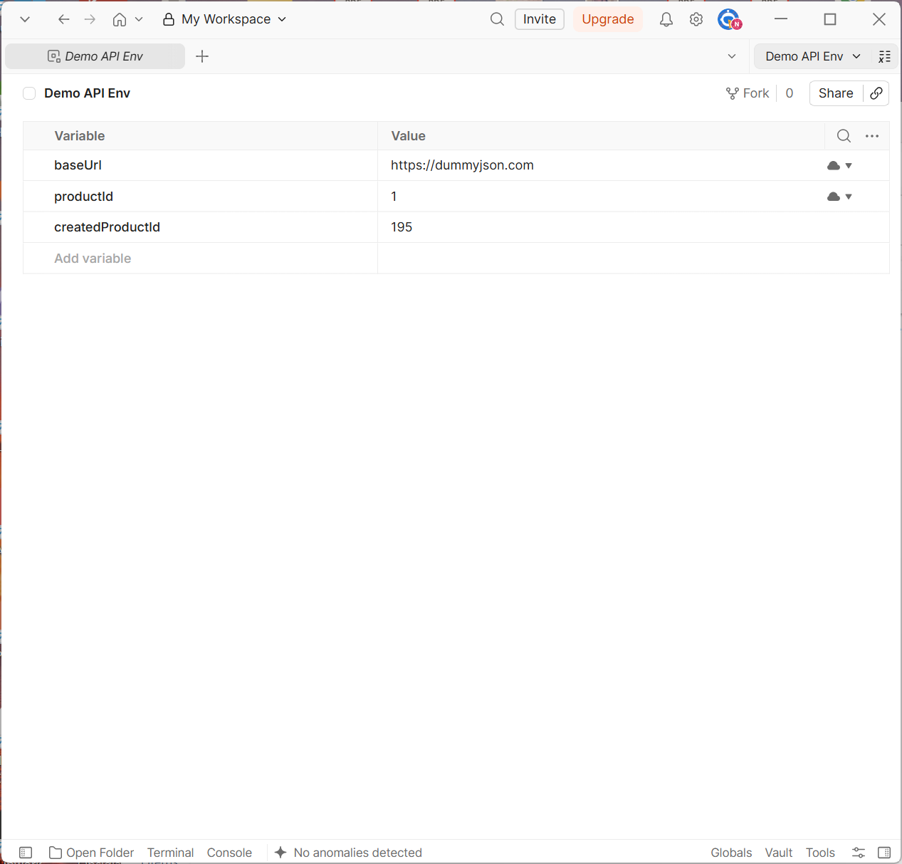

## 3. Requêtes

### Requête 1 : Lire un produit

- **Méthode :** GET
- **URL :** `{{baseUrl}}/products/{{productId}}`
- **Corps :** aucun
- **Statut reçu :** 200 OK

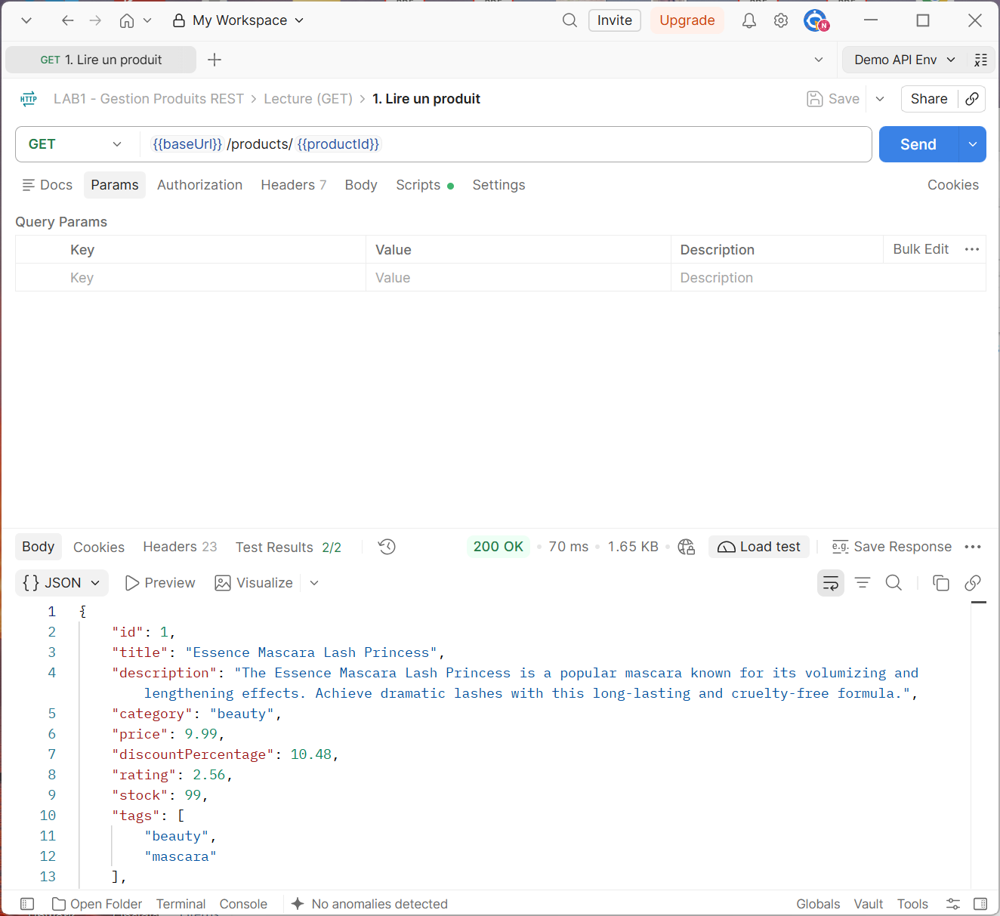

**Observation :** L'API renvoie le produit 1, « Essence Mascara Lash Princess », avec ses champs `id`, `title` et `price`.

### Requête 2 : Rechercher des produits

- **Méthode :** GET
- **URL :** `{{baseUrl}}/products/search?q=phone`
- **Corps :** aucun
- **Statut reçu :** 200 OK

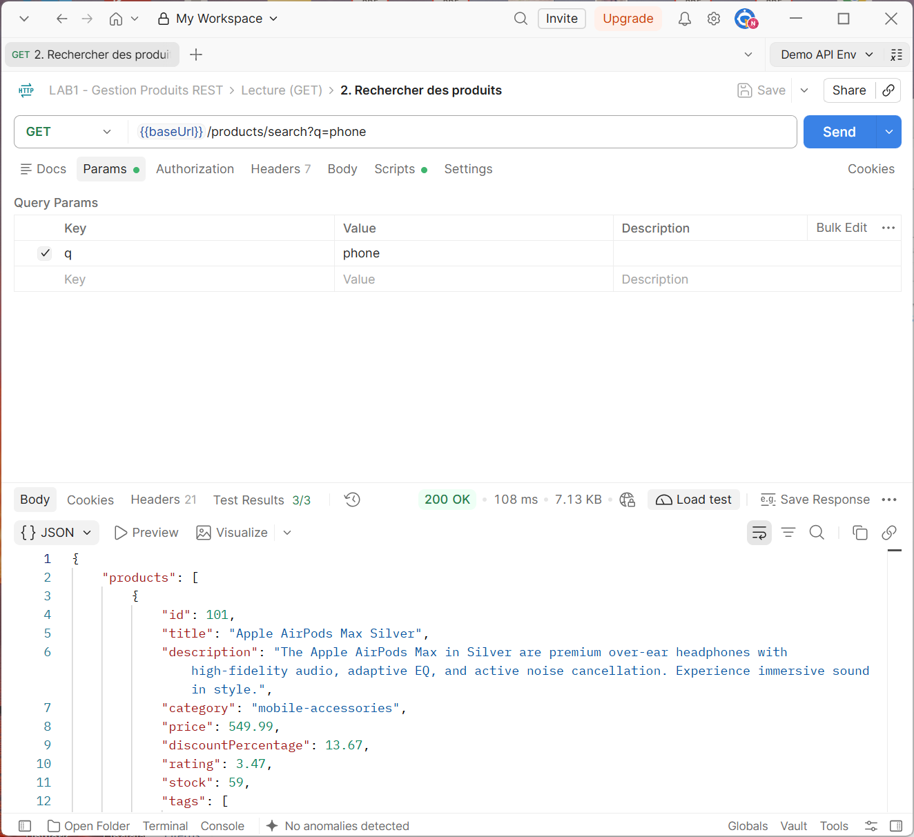

**Observation :** La réponse contient un tableau `products` avec 23 résultats. La recherche porte aussi sur la description : certains produits n'ont pas « phone » dans leur titre.

### Requête 3 : Créer un produit

- **Méthode :** POST
- **URL :** `{{baseUrl}}/products/add`
- **Corps :**

```json
{"title":"Casque Audio Sans Fil","price":129.99,"category":"audio","stock":25}
```

- **Statut reçu :** 201 Created

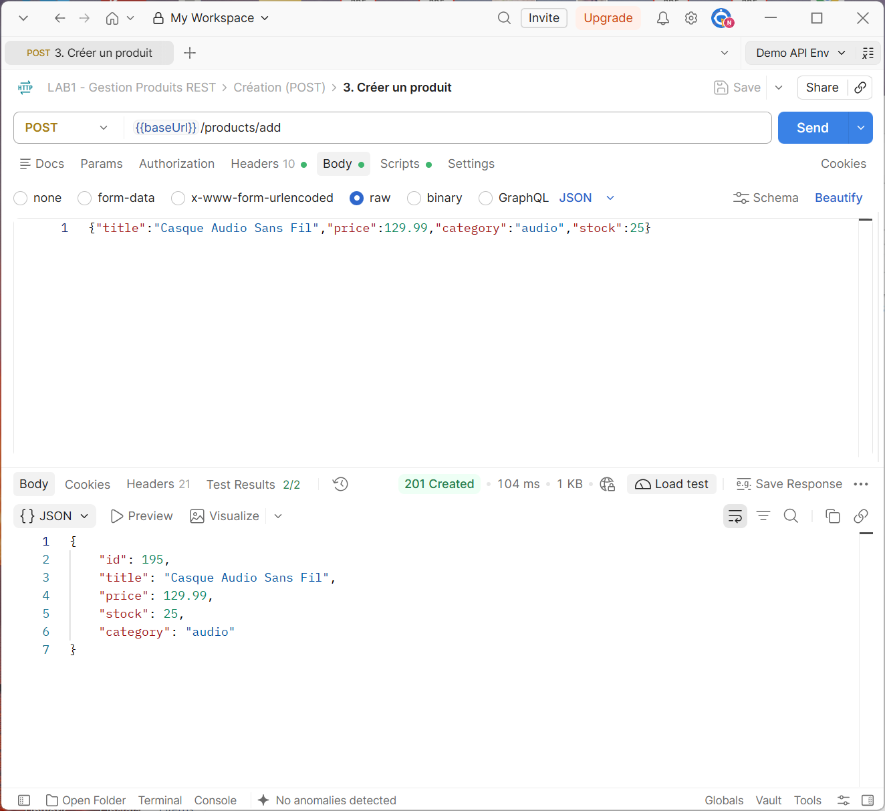

**Observation :** L'API renvoie le produit avec l'`id` 195, enregistré dans la variable `createdProductId`. dummyjson simule la création : le produit n'est pas réellement enregistré.

### Requête 4 : Remplacer un produit

- **Méthode :** PUT
- **URL :** `{{baseUrl}}/products/{{productId}}`
- **Corps :**

```json
{"title":"Casque Audio Pro (Mise à jour)","price":149.99,"category":"audio","stock":10}
```

- **Statut reçu :** 200 OK

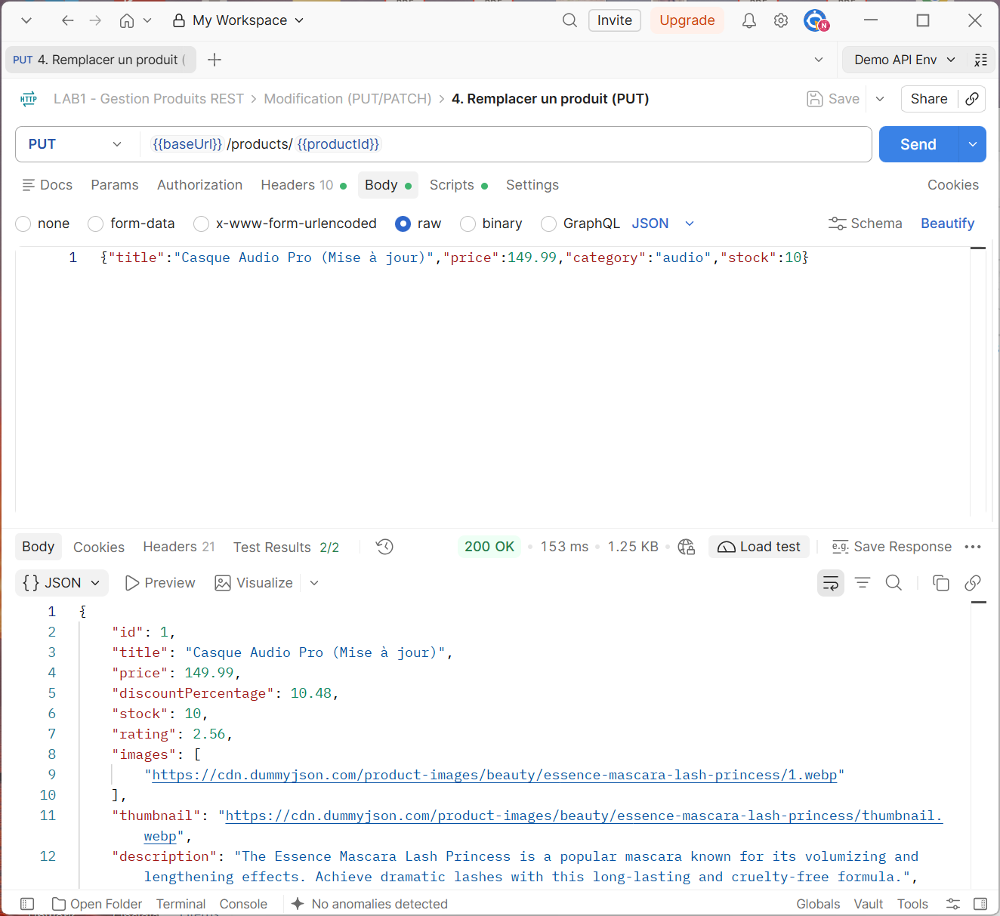

**Observation :** La réponse contient les nouvelles valeurs. Les champs non envoyés, comme `rating`, restent présents : dummyjson ne remplace donc pas toute la ressource.

### Requête 5 : Modifier le prix

- **Méthode :** PATCH
- **URL :** `{{baseUrl}}/products/{{productId}}`
- **Corps :**

```json
{"price":139.99}
```

- **Statut reçu :** 200 OK

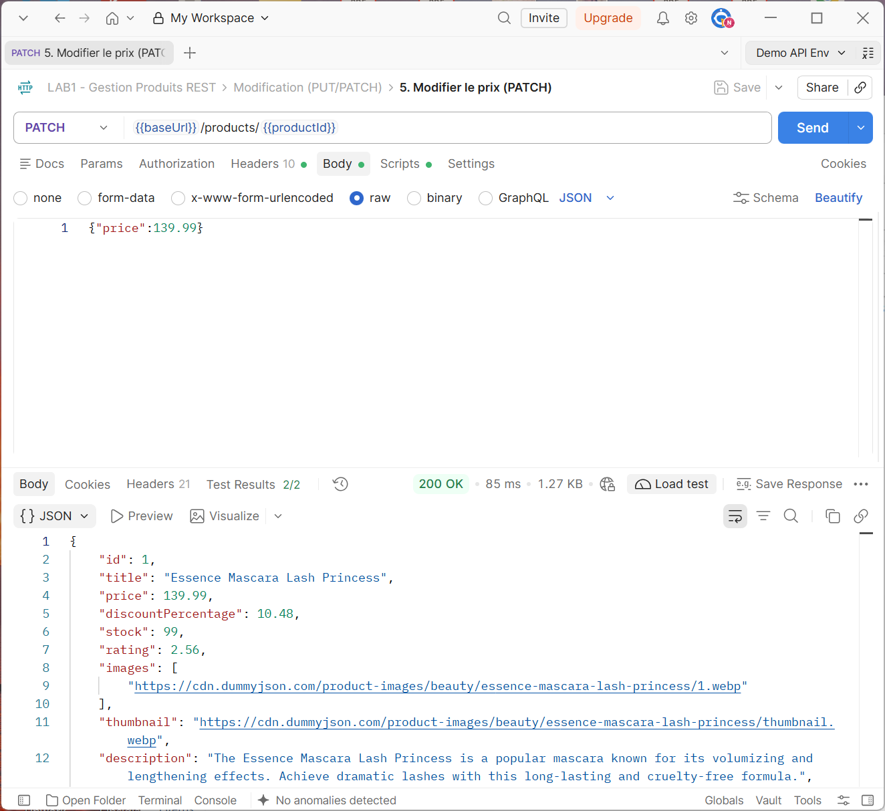

**Observation :** Le prix passe à 139.99 et les autres champs ne changent pas. Le titre reste « Essence Mascara Lash Princess », car la modification de la requête 4 n'a pas été enregistrée.

### Requête 6 : Supprimer un produit

- **Méthode :** DELETE
- **URL :** `{{baseUrl}}/products/{{productId}}`
- **Corps :** aucun
- **Statut reçu :** 200 OK

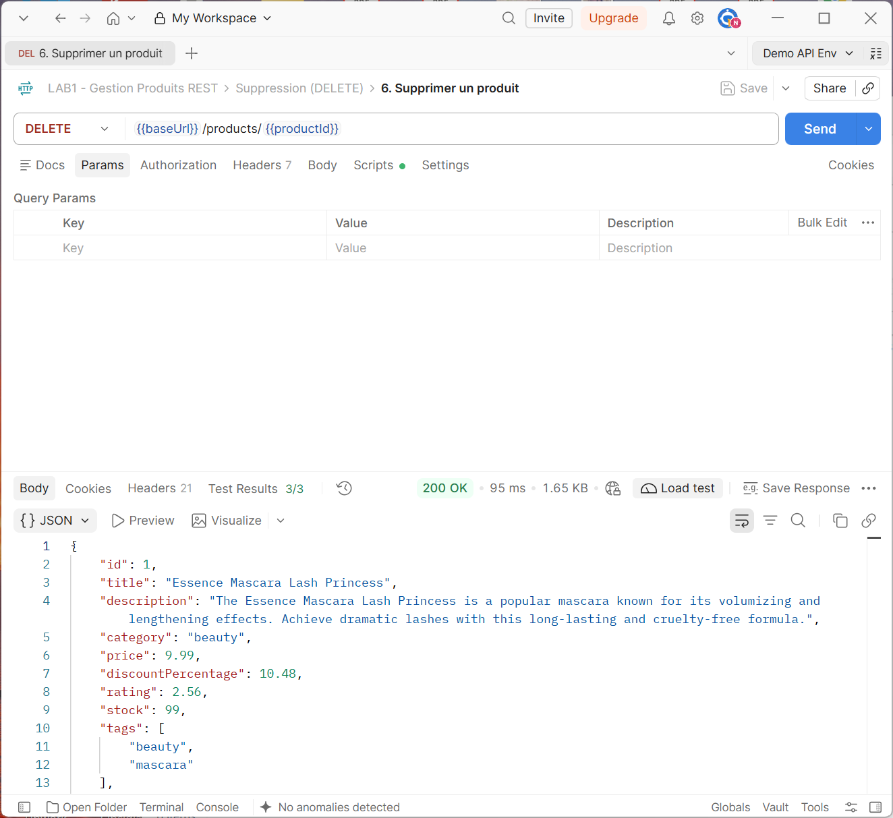

**Observation :** La réponse contient `isDeleted: true` et la date `deletedOn`. La suppression est simulée : la requête 11 retrouve encore le produit 1.

### Requête 7 : Produit inexistant

- **Méthode :** GET
- **URL :** `{{baseUrl}}/products/99999`
- **Corps :** aucun
- **Statut reçu :** 404 Not Found

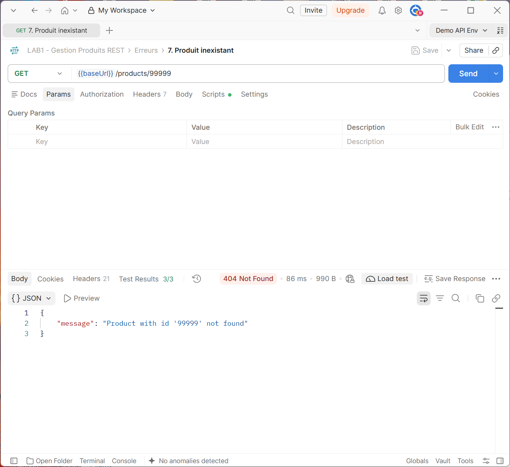

**Observation :** L'API renvoie le message « Product with id '99999' not found ».

### Requête 8 : JSON mal formé

- **Méthode :** POST
- **URL :** `{{baseUrl}}/products/add`
- **Corps :**

```text
{"title":"Casque Audio Sans Fil","price":}
```

- **Statut reçu :** 400 Bad Request

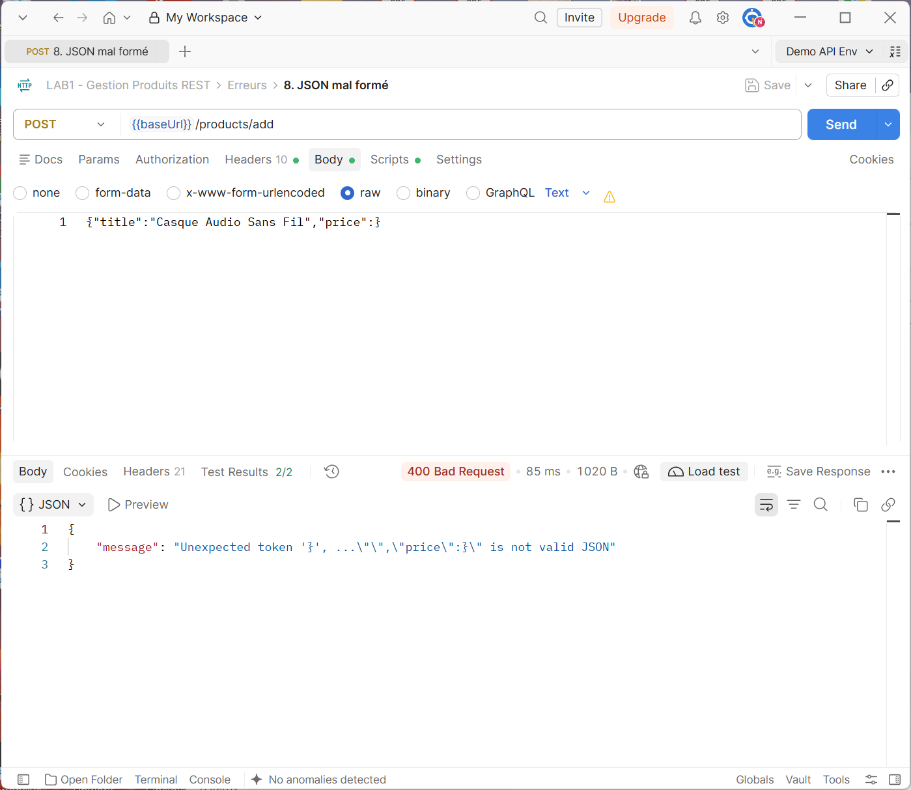

**Observation :** La valeur de `price` est absente, donc le JSON est invalide. L'API refuse la requête et renvoie un message d'erreur.

### Requête 9 : Produits par catégorie

- **Méthode :** GET
- **URL :** `{{baseUrl}}/products/category/smartphones`
- **Corps :** aucun
- **Statut reçu :** 200 OK

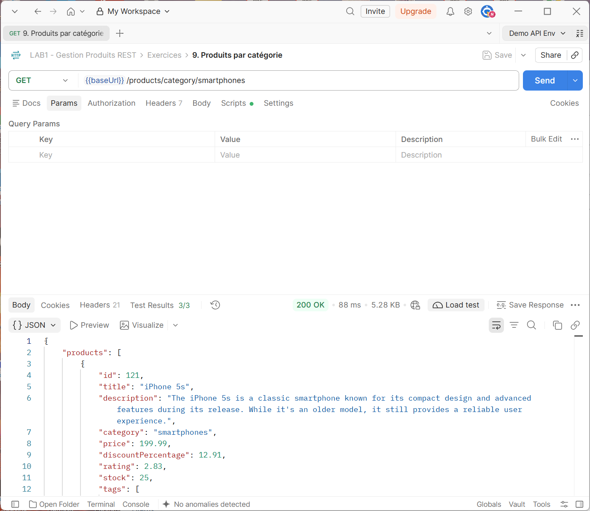

**Observation :** L'API renvoie 16 produits, tous dans la catégorie `smartphones`.

### Requête 10 : Créer un utilisateur

- **Méthode :** POST
- **URL :** `{{baseUrl}}/users/add`
- **Corps :**

```json
{"firstName":"Amine","lastName":"Benali","age":25}
```

- **Statut reçu :** 201 Created

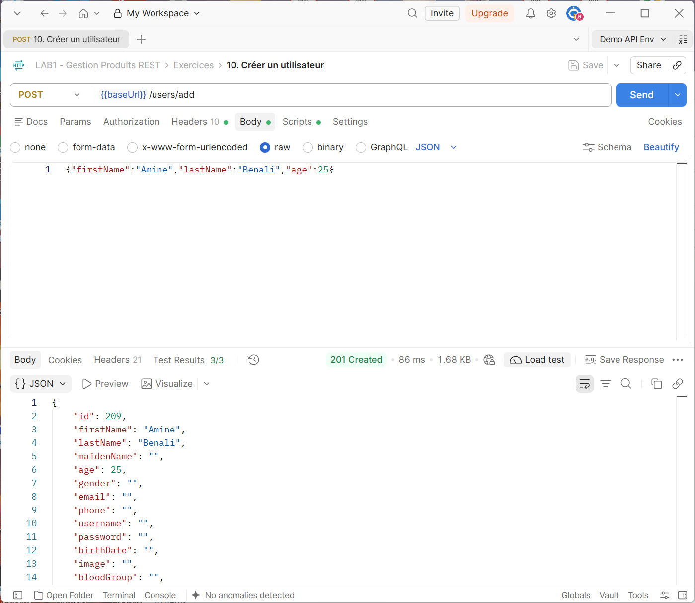

**Observation :** La réponse contient un `id` et le `firstName` envoyé, « Amine ».

### Requête 11 : Temps de réponse

- **Méthode :** GET
- **URL :** `{{baseUrl}}/products/{{productId}}`
- **Corps :** aucun
- **Statut reçu :** 200 OK

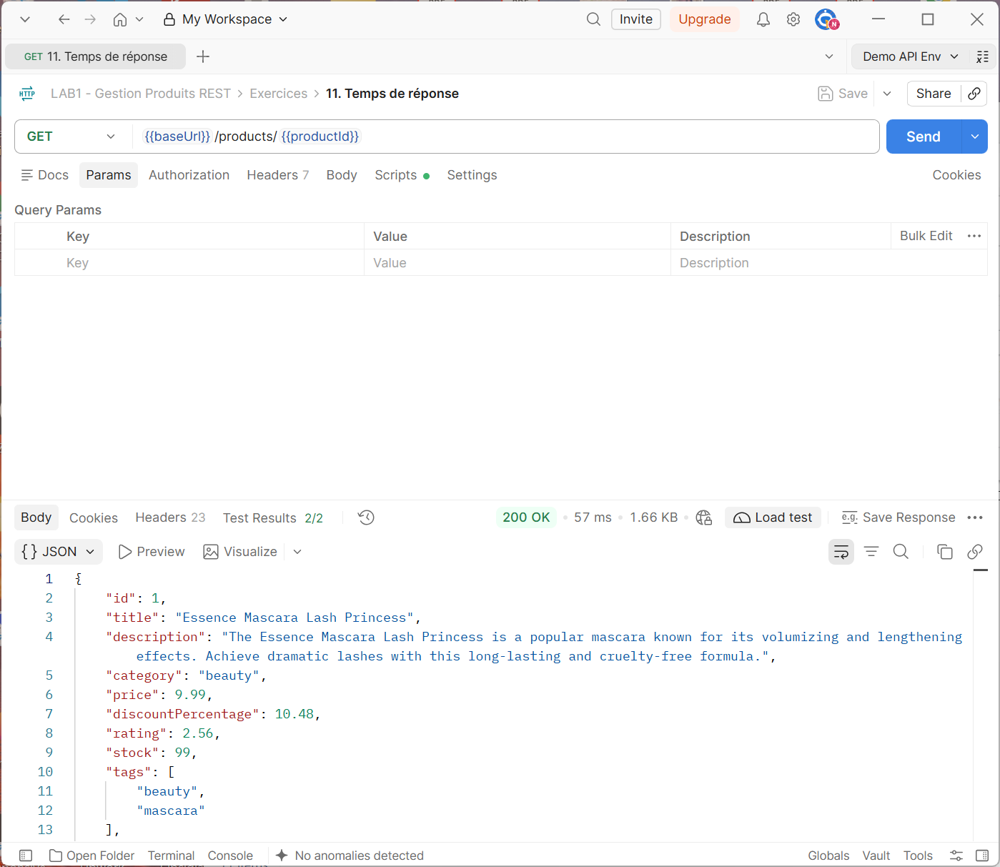

**Observation :** La réponse arrive en 57 ms, sous la limite de 500 ms. Ce temps peut varier selon le réseau.

## 4. Codes HTTP

| Code | Signification | Explication |
|------|---------------|-------------|
| 200 | OK | La requête a réussi et la réponse contient le résultat. |
| 201 | Created | Une nouvelle ressource a été créée. |
| 204 | No Content | La requête a réussi et la réponse n'a pas de corps. |
| 400 | Bad Request | La requête est invalide, par exemple un JSON mal formé. |
| 404 | Not Found | La ressource demandée n'existe pas. |
| 500 | Internal Server Error | Une erreur s'est produite côté serveur. |

## 5. Comparaison PUT et PATCH

| | PUT | PATCH |
|---|-----|-------|
| **Rôle** | Remplace toute la ressource | Modifie une partie de la ressource |
| **Corps envoyé** | La ressource complète | Seulement les champs à modifier |
| **Exemple du lab** | `title`, `price`, `category`, `stock` | `price` |
| **Idempotence** | Oui | Pas forcément |

## 6. Conclusion

Ce lab m'a permis de tester les principales méthodes HTTP avec Postman, de lire les codes de statut et d'automatiser les vérifications avec des tests. Les 11 requêtes ont donné les résultats attendus. J'ai aussi constaté que dummyjson simule les écritures : les réponses sont correctes, mais les données ne changent pas réellement.
